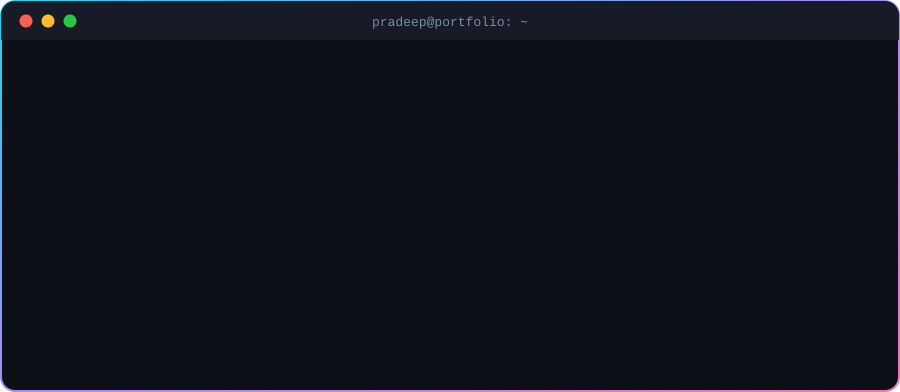
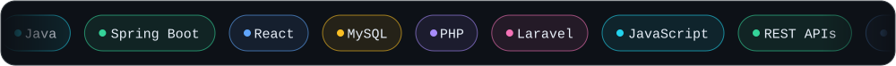

 

  

  

 

 

I'm a Computer Science graduate and aspiring **Java Full Stack Developer** with hands-on experience building web apps using **PHP Laravel, MySQL, JavaScript and Bootstrap**. During my internship I worked on a **Human Resource Management System (HRMS)**, gaining practical experience in backend development, database design, authentication and MVC architecture.

Right now I'm levelling up on **Java, Spring Boot, REST APIs and React** to build production-ready full stack applications.

 

 

  

  

 

  

 

  

 

  

 

  

  

  

<!-- Needs .github/workflows/snake.yml to run once -->
<picture>
  <source media="(prefers-color-scheme: dark)" srcset="https://raw.githubusercontent.com/Ppradeep123/Ppradeep123/output/github-snake-dark.svg" />
  <source media="(prefers-color-scheme: light)" srcset="https://raw.githubusercontent.com/Ppradeep123/Ppradeep123/output/github-snake.svg" />
  
</picture>

  

 

**Career objective:** to start my career as a Java Full Stack Developer, building scalable, efficient software while growing as an engineer.

I'm open to **entry-level Java / Software Developer roles**, collaboration and learning opportunities.

 

  

